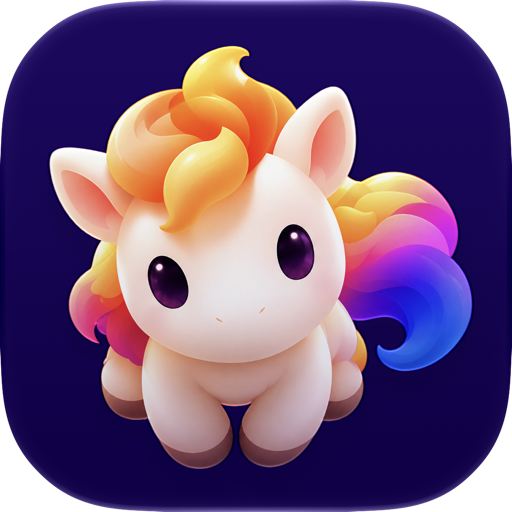

<p align="center">
  
</p>

<h1 align="center">Zurafa</h1>

<p align="center">
  A macOS terminal workspace powered by a SwiftUI app and Rust daemon.
</p>

<p align="center">
  <a href="https://github.com/devjasha/Zurafa/stargazers"></a>
  <a href="https://github.com/devjasha/Zurafa/releases"></a>
  
  
</p>

A macOS terminal workspace: a SwiftUI app (`apps/macos`) whose terminals and workspace state live in a Rust daemon (`rust/`). The `zurafa-events` crate owns typed events, subscriptions, and snapshots; the socket protocol is documented in `docs/ipc-protocol.md`.

**Website:** [zurafa.rare-haven-5290.chatgpt.site](https://zurafa.rare-haven-5290.chatgpt.site) · **Documentation:** [Getting started and reference](https://zurafa.rare-haven-5290.chatgpt.site/docs/)

## Achievements

<p>
  <a href="https://github.com/devjasha/Zurafa/stargazers"></a>
  <a href="https://github.com/devjasha/Zurafa/network/members"></a>
  <a href="https://github.com/devjasha/Zurafa/watchers"></a>
</p>

- Native macOS app with a SwiftUI interface and Rust-powered daemon.
- Signed release builds with Sparkle auto-update support.
- Typed event, subscription, and snapshot protocol for terminal workspaces.
- Early `zurafa` CLI for daemon automation and inspection.
- Import support for Ghostty terminal appearance settings.

## Download for macOS

Download the latest macOS DMG from [GitHub Releases](https://github.com/devjasha/Zurafa/releases), open it, and drag `Zurafa.app` into Applications. The current beta supports Apple Silicon Macs running macOS 14 or newer.

Release builds are signed with Developer ID and can be notarized with Apple before publishing. The app includes Sparkle auto-updates and checks `https://zurafa-website.vercel.app/appcast.xml`.

## Build and run

```sh
scripts/bundle.sh          # cargo + swift release builds, then build/zurafa-development.app (ad-hoc signed)
scripts/release-macos.sh   # signed release zip + dmg in build/
open build/zurafa-development.app  # starts its own dev daemon, separate from Zurafa.app
```

To notarize during release, provide either a notarytool keychain profile:

```sh
BUILD_NUMBER=2 NOTARY_PROFILE=zurafa scripts/release-macos.sh 0.1.1
```

or Apple ID credentials:

```sh
BUILD_NUMBER=2 APPLE_ID=you@example.com APP_SPECIFIC_PASSWORD=xxxx-xxxx-xxxx-xxxx scripts/release-macos.sh 0.1.1
```

Development without bundling:

```sh
(cd rust && cargo build)
cd apps/macos && ZURAFA_DAEMON=../../rust/target/debug/zurafa-daemon ZURAFA_SOCKET="$HOME/Library/Application Support/ZurafaDevelopment/daemon.sock" swift run
```

Tests: `cargo test` in `rust/`, `swift test` in `apps/macos/`.
Stop the daemon with `pkill zurafa-daemon` (this ends every terminal).

The app uses protocol 2. If an older daemon is still running after an upgrade,
stop it before opening the new app. This ends terminals owned by that older daemon.
After a daemon restart, the app reconnects and rebuilds its layout from a fresh
snapshot. Terminal screen output produced while the app is disconnected is not replayed.

Click the workspace name to switch sessions. Use ⌘K for the command picker,
including session rename, new session, and Add Remote Host. The Add Host picker
accepts a host name, SSH alias, `user@host:port`, or `ssh://user@host:port`. If
Tailscale is running, it also lists your online Linux and Mac tailnet machines,
and it lists VMs running on this Mac's shared network (UTM, Tart, Apple
Virtualization), such as a Kali or Parrot VM; pick one to save it and connect.
A VM needs `sshd` running and, for daemon-backed tabs, your SSH key
(`ssh-copy-id user@vm-ip`). Set the VM user with Edit Connection or `~/.ssh/config`.
Remote tabs keep their shells in a Zurafa daemon on the remote host, installed
over SSH on first use (Linux x86_64/arm64 and Apple silicon Macs), so they survive
dropped connections and sleep. The SSH connection uses saved host details and your
normal macOS SSH configuration; it needs key or agent authentication. Hosts that
need a password, or that the daemon can't run on, fall back to plain SSH tabs.
On a Linux tailnet host, the bolt button next to a saved host installs a Zurafa
service there. Tabs then connect directly over Tailscale (HTTPS through Tailscale
Serve, or tailnet port 7297) without SSH, much like Rex. A root login server
(`sudo zurafa-daemon install-login-server`) hands each Tailscale caller to the
account `/etc/zurafa/accounts.jsonc` allows. See the website's
[Direct over Tailscale](https://zurafa-website.vercel.app/docs/remote-access/) guide and `docs/ipc-protocol.md`. Saved hosts persist on disk, while open
sessions and their PTYs live only for the current daemon process.
Use ⌘K to choose Follow System, Light, or Dark appearance immediately; ⇧⌘A
switches between light and dark. Zurafa remembers the choice across launches. In Follow
System mode, the window and terminals update when macOS changes appearance.

Use ⌘K → Import Ghostty Settings to copy terminal font, font size, foreground,
background tint, cursor, selection, and ANSI palette settings from Ghostty's
standard XDG and macOS configuration paths. Includes and named light/dark themes
are supported. Zurafa keeps its own glass window design and does not import
Ghostty keybindings, shell commands, or window layout. Reimport after changing
Ghostty's files, or choose Use Zurafa Terminal Defaults to undo the import.
Press ⌘, to open `~/.config/config.zurafa` (or `$XDG_CONFIG_HOME/config.zurafa`)
in your default text editor. The first time, Zurafa writes a commented template
listing every setting. Changes apply as soon as you save. Settings include
`theme` (any Ghostty theme name, or `light:A,dark:B`), terminal colors and font,
`accent-color`, `window-opacity`, `pane-gap`, `pane-padding`,
`pane-corner-radius`, `unfocused-pane-opacity`, `sidebar-width`, and the
background image. Values in this file override imported Ghostty settings.

Terminal panes bundle Symbols Nerd Font Mono as an icon fallback. The chosen
terminal font still renders ordinary text and any icons it already contains;
only missing Nerd Font symbols use the bundled face.

The Rust workspace also builds the early CLI as `zurafa`:

```sh
(cd rust && cargo run -p zurafa-cli -- --help)
```

The static website and documentation source live in `website/`. Run
`python3 website/build.py` and `python3 website/check.py` to rebuild and verify
its generated `website/dist/` pages.
